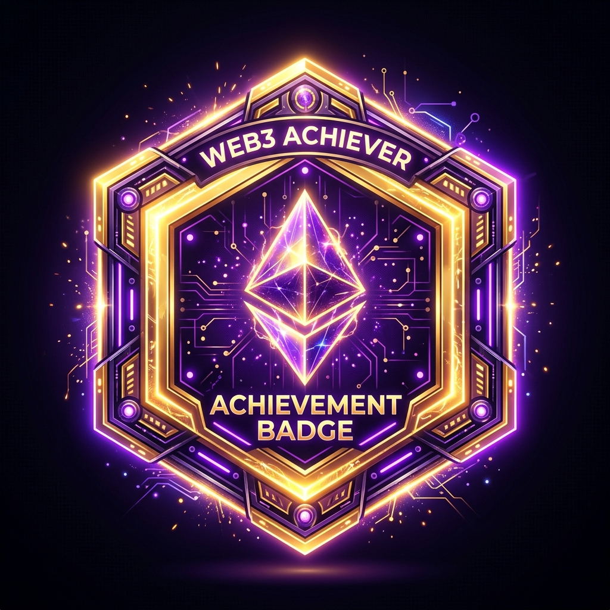
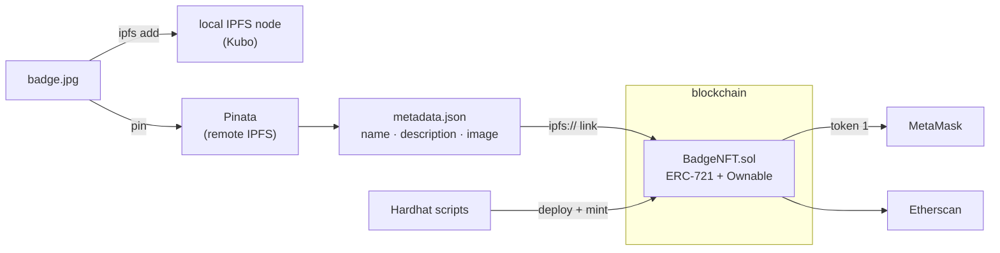
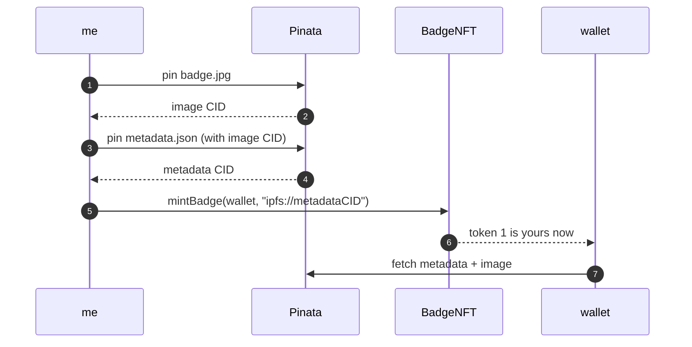

# nft-101: my very first NFT badge

hiii, this is a tiny project from my Blockchain lab (OEIT1, Lab 6A @ SPIT Mumbai) where I made my own **achievement badge as an NFT**, stored it on IPFS, and sent it to my wallet. it's live on the Sepolia testnet and it shows up in MetaMask too.

<p align="center">
  
</p>

the lab book was from 2022 and half the tools in it are dead now (Truffle, Rinkeby, Ropsten, RIP), so this is the updated 2026 way to do it.

---

## how it all fits together

the idea is simple: the blockchain only stores **who owns the badge** and a tiny link to its metadata. the actual picture and details live on IPFS, which is addressed by content, so nobody can quietly swap the image later.



and here's what happens when a badge gets awarded:



**the stack:** Solidity 0.8.28 · OpenZeppelin 5.4 · Hardhat 2 + ethers v6 · Ganache (local) · Sepolia (testnet) · Kubo + Pinata (IPFS) · MetaMask

**where's the stuff**
- `contracts/BadgeNFT.sol` is the NFT itself. only the owner can award badges
- `scripts/` has deploy, mint, check, pin-to-pinata and verify-sourcify
- `test/` has the little unit tests
- `showcase.html` is a cute page that shows the badge and adds it to MetaMask in one click

**it's live!** contract [`0x0De3…777b`](https://sepolia.etherscan.io/nft/0x0De32F99FCdC12f78eb8bFB377921B0E3a7b777b/1) on Sepolia, token #1, verified on [Sourcify](https://repo.sourcify.dev/11155111/0x0De32F99FCdC12f78eb8bFB377921B0E3a7b777b)

> small gotcha I hit: Ganache is discontinued and stuck on an older EVM, and the newest OpenZeppelin uses an opcode Ganache doesn't know (MCOPY). so the contract compiles for `shanghai` and OpenZeppelin is pinned to 5.4. took me a minute lol

---

## run it yourself

you'll need Node 20+, and if you want the local IPFS bit, [Kubo](https://docs.ipfs.tech/install/command-line/) or IPFS Desktop.

```bash
git clone https://github.com/Rio-0912/nft-101.git
cd nft-101
npm install
cp .env.example .env      # then fill it in
```

in `.env`, put a **test-only** wallet key (please never a wallet with real money), your Pinata JWT, and the Ganache key it prints for you. every variable is explained in `.env.example`.

**locally on Ganache**
```bash
npm test                  # make sure everything's happy
npm run ganache           # keep this one running in its own terminal
npm run pin               # puts the image + metadata on IPFS, gives you TOKEN_URI
npm run deploy:ganache
npm run mint:ganache
npm run check:ganache     # reads the badge back from the chain
```

**on Sepolia**
grab some free test ETH from the [Google Cloud faucet](https://cloud.google.com/application/web3/faucet/ethereum/sepolia) first, then:
```bash
npm run deploy:sepolia
npm run mint:sepolia
npm run verify:sourcify
npm run check:sepolia
```

**see it in MetaMask**
switch to Sepolia → NFTs → Import NFT → paste your contract address and token ID `1`. if the picture shows up blank, set the IPFS gateway in MetaMask settings to `gateway.pinata.cloud`.

the full step-by-step for the lab (with screenshot captions) is in [`LAB_GUIDE.md`](LAB_GUIDE.md).

---

made with way too much chai and a bit of chaos by Rehan · MIT licensed, go make your own badge!
